# Rectangles: intersection, containment and adjacency


A small, dependency free Python library and command line tool that analyzes how two axis aligned rectangles relate to each other.

## The problem in brief

This repository is my solution to EY's "Rectangles" take home exercise. Given two rectangles, the code answers three questions:

* **Intersection:** do the sides of the two rectangles cross, and if so, at which points?
* **Containment:** is one rectangle wholly inside the other?
* **Adjacency:** do the rectangles sit side by side sharing part of a side, and is that share *proper* (identical sides), *sub-line* (one side lies wholly within the other) or *partial* (the sides only partly overlap)?

## Quick start (Linux, macOS, WSL)

Requirements: Python 3.10 or newer. Nothing else: no packages to install, no build step.

```bash
git clone https://github.com/Gambit-02/rectangles-exercise.git
cd rectangles-exercise
python3 -m unittest                              # run all 80 tests (about 3 seconds)
python3 -m rectangles demo                       # analyze every scenario from the assignment's appendix
python3 -m rectangles analyze 0,0,4,4 2,2,6,6    # analyze your own pair
```

Output of the last command:

```text
A: [(0, 0) -> (4, 4)]
B: [(2, 2) -> (6, 6)]
Relation: intersecting (their sides cross)

Intersection: yes
  points:   (2, 4), (4, 2)
  segments: none
Containment: no
Adjacency: no
```

Optionally, `python3 -m pip install .` installs a `rectangles` command that works from any folder.

## Using it as a library

```python
from rectangles import Rectangle, analyze, contains, find_adjacency, find_intersection

a = Rectangle(0, 0, 8, 8)  # left, bottom, right, top
b = Rectangle(8, 5, 12, 11)

print(find_intersection(a, b).intersects)  # False
print(contains(a, b))  # False
print(find_adjacency(a, b).kind)  # AdjacencyType.PARTIAL
print(analyze(a, b).relation)  # Relation.ADJACENT
```

Rectangles can also be built from any two opposite corners with `Rectangle.from_corners((x1, y1), (x2, y2))`, or from a corner and a size with `Rectangle.from_origin_size(x, y, width, height)`. Coordinates may be ints, floats or `fractions.Fraction` values.

| Function | Returns |
|---|---|
| `find_intersection(a, b)` | `IntersectionResult(intersects, points, segments)` |
| `intersects(a, b)` | `bool` |
| `contains(outer, inner)` / `strictly_contains(outer, inner)` | `bool` |
| `find_adjacency(a, b)` | `AdjacencyResult(adjacent, kind, shared_segment, side_of_a, side_of_b)` |
| `is_adjacent(a, b)` | `bool` |
| `analyze(a, b)` | `RelationshipReport` with all of the above, a `Relation`, and `describe()` / `to_dict()` |
| `boundary_contact(a, b)` | every point the two boundaries share, with no interpretation |

## Command line usage

Each rectangle is written as `x1,y1,x2,y2`: any two opposite corners, in any order, as integers or decimals.

| Command | What it does |
|---|---|
| `python3 -m rectangles analyze A B` | text report for one pair |
| `python3 -m rectangles analyze --json A B` | the same report as JSON |
| `python3 -m rectangles analyze A B --svg pair.svg` | also draws the pair as an SVG picture |
| `python3 -m rectangles demo [--json]` | analyzes all 19 built in scenarios |
| `python3 -m rectangles gallery DIR` | writes one SVG per scenario (this is how `docs/images` was made) |

Excerpt of `python3 -m rectangles analyze --json 0,0,8,8 8,5,12,11`:

```json
  "relation": "adjacent",
  "adjacency": {
    "adjacent": true,
    "kind": "partial",
    "shared_segment": [[8, 5], [8, 8]],
    "side_of_a": "right",
    "side_of_b": "left"
  },
```

Negative coordinates: the command line parser reads a leading minus sign as an option, so put `--` before the rectangles:

```bash
python3 -m rectangles analyze -- -1,-1,2,2 0,0,3,3
```

Invalid input (wrong number of values, zero width, `nan`, text) produces a clear error message and exit code 2.

## Definitions

The assignment leaves several cases open (touching corners, shared edges, nested rectangles that touch, identical rectangles). These are the exact rules the code follows. Rectangles are axis aligned and closed: their four sides belong to them.

| Feature | Plain language | Precise rule |
|---|---|---|
| **Intersection** | The sides of the two rectangles cross each other. | The interiors overlap **and** neither rectangle contains the other. The result lists the points where the boundaries meet, plus any segments where sides lie on top of each other. |
| **Containment** | One rectangle lies wholly within the other. Touching the outer rectangle's edge from the inside is allowed. | `outer.left <= inner.left`, `inner.right <= outer.right`, `outer.bottom <= inner.bottom`, `inner.top <= outer.top`. Every rectangle contains itself. |
| **Adjacency** | The rectangles sit side by side and share part of a side. | The interiors do **not** overlap and a side of A shares a segment of positive length with a side of B. **Proper:** the shared segment is both full sides. **Sub-line:** it is exactly one full side. **Partial:** it is neither. |

On top of the three features, `analyze()` places every pair in exactly one of seven relations: `equal`, `a_contains_b`, `b_contains_a`, `intersecting`, `adjacent`, `touching` (only a corner point is shared) or `disjoint`.

A useful consequence: **intersection, containment and adjacency are mutually exclusive.** At most one of them applies to any pair, and the tests prove it.

## The appendix, reproduced

Every diagram from the assignment's appendix is encoded as a named scenario in [`rectangles/scenarios.py`](rectangles/scenarios.py), tested in [`tests/test_scenarios.py`](tests/test_scenarios.py), and drawn by the gallery command. Blue is A, orange is B, red marks where the boundaries meet.

**Appendix 1: Intersection**

<table>
<tr>
<td>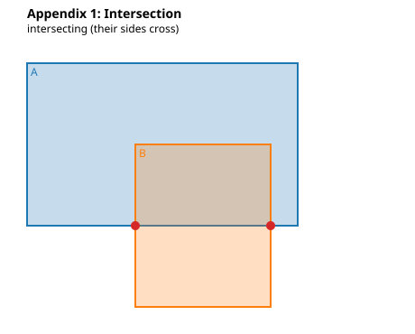<br>Intersection: points (4, 4) and (9, 4)</td>
<td>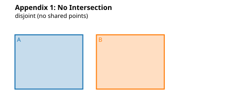<br>No Intersection</td>
</tr>
</table>

**Appendix 2: Containment**

<table>
<tr>
<td>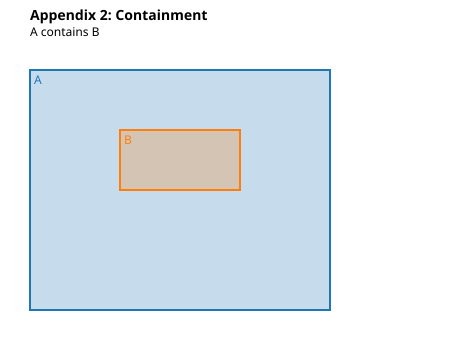<br>Containment</td>
<td>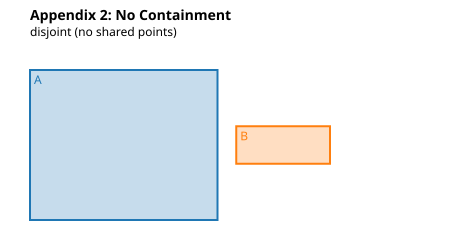<br>No Containment</td>
<td>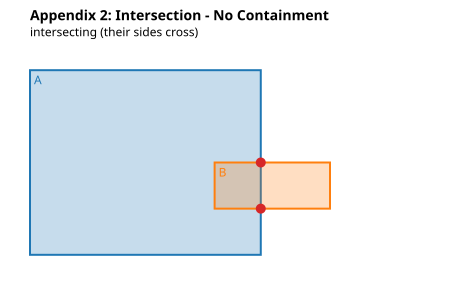<br>Intersection, no containment: points (10, 2) and (10, 4)</td>
</tr>
</table>

**Appendix 3: Adjacency**

<table>
<tr>
<td>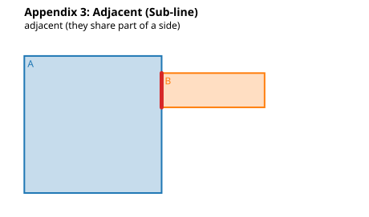<br>Adjacent (sub-line)</td>
<td>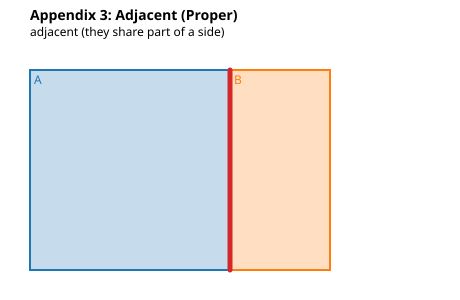<br>Adjacent (proper)</td>
</tr>
<tr>
<td>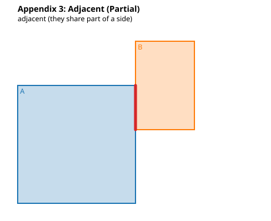<br>Adjacent (partial)</td>
<td>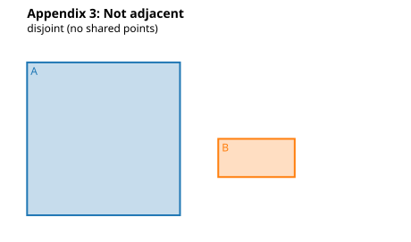<br>Not adjacent</td>
</tr>
</table>

## Edge cases and decisions

| Situation | Answer | Reason |
|---|---|---|
| B strictly inside A | Containment, **not** intersection | Appendix 2 treats containment and intersection as different outcomes, and the sides never meet. |
| B inside A, flush against one of A's sides | Containment; the report adds a "Shared boundary" line | B is still wholly within A. Adjacency means side by side, as in every Appendix 3 drawing. |
| Side by side sharing an edge | Adjacent, not intersecting | Adjacency is its own feature; tiles on a floor touch but do not intersect. |
| Only corners touch | `touching`: neither adjacent nor intersecting | A single point is not a shared line segment. |
| Identical rectangles | `equal`: each contains the other | Containment is inclusive. |
| Overlapping with collinear sides | Intersecting; result includes points **and** segments | That is the exact answer; a segment cannot be listed as a finite set of points. |
| Sub-line share that starts at a corner | Sub-line | One side still lies wholly within the other. |
| Zero width or zero height | Rejected with `ValueError` | A degenerate rectangle is a line or a point. |
| `bool`, strings, `None`, `Decimal`, `nan`, infinity | Rejected with `TypeError` / `ValueError` | `True == 1` in Python, so a boolean coordinate is almost certainly a bug. |
| Rotated rectangles | Out of scope | Every appendix diagram is axis aligned (see future work). |

<table>
<tr>
<td>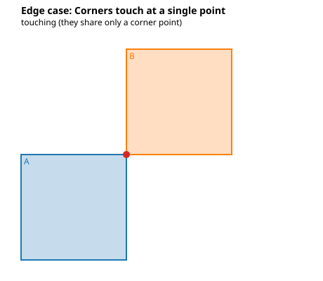<br>Corners touch</td>
<td>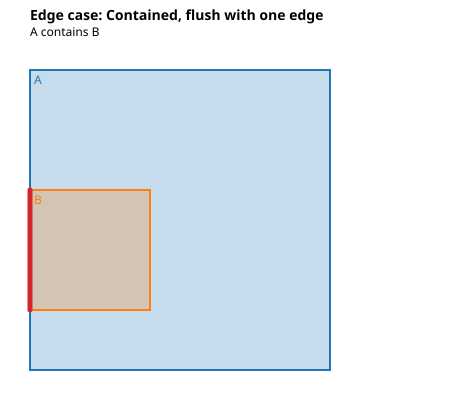<br>Contained, flush with an edge</td>
</tr>
<tr>
<td>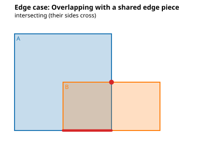<br>Intersecting, with a shared edge piece</td>
<td>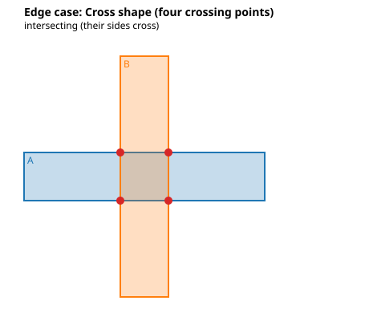<br>Cross shape: four intersection points</td>
</tr>
</table>

The reasoning behind each decision is in [`docs/DESIGN.md`](docs/DESIGN.md).

## How it works

* **Segments** (`geometry.intersect_segments`): two horizontal segments can only meet on the same y, over the overlap of their x ranges; that overlap is empty, a single point, or a segment. Vertical segments work the same way. A horizontal and a vertical segment can only meet at (x of the vertical one, y of the horizontal one).
* **Boundary contact** (`intersection.boundary_contact`): compare each of A's four sides with each of B's four sides (16 checks), collect shared points and segments, drop points that already lie on a shared segment, and sort the results.
* **Containment:** four comparisons.
* **Intersection:** check that the interiors overlap (four strict comparisons) and that neither rectangle contains the other; if so, the points of intersection are the boundary contact.
* **Adjacency:** if the interiors overlap, the rectangles are not adjacent. Otherwise only facing sides can touch (A's right with B's left, A's top with B's bottom, and the two mirror cases), so check those four pairs. Comparing the shared segment with the two full sides gives proper, sub-line or partial.

Every operation is O(1) per pair. The algorithms only **compare** coordinates and take minimums and maximums; they never add, subtract, multiply or divide them. So no rounding error can creep in, no epsilon is needed, and the answers are exact for ints, floats and fractions alike.

## Testing

```bash
python3 -m unittest                               # everything
python3 -m unittest tests.test_adjacency -v       # one file
```

The 80 tests are layered:

1. **Unit tests per module** with hand checked vectors: segment intersection, validation, containment, intersection points, all three adjacency kinds in all four directions, exact text and JSON output.
2. **Every appendix diagram** as a named scenario test, plus ten edge case scenarios.
3. **An exhaustive brute force oracle** ([`tests/test_properties.py`](tests/test_properties.py)). For all 10,000 ordered pairs of rectangles on a 5 by 5 integer grid, an independent implementation that simply samples points on a fine grid computes the true answer to every question, and the library must agree exactly. The oracle samples at half steps (coordinates doubled), which lets it tell a shared segment of length one apart from two separate endpoints.
4. **Invariants** on 2,000 seeded random pairs: swapping the arguments, translating both rectangles, and mirroring across the line y = x must never change the answer.
5. **Doctests:** the examples in the docstrings run as tests, so the documentation cannot drift from the code.
6. **Continuous integration:** GitHub Actions runs the suite, the demo and a package install on Ubuntu with Python 3.10, 3.11, 3.12 and 3.13.

During development the same oracle also agreed with the library on all 194,481 pairs of a 7 by 7 grid.

## Project structure

```text
rectangles/
  geometry.py       Point, Segment, Side, Rectangle; segment intersection; interior overlap
  containment.py    contains, strictly_contains
  intersection.py   boundary_contact, intersects, find_intersection
  adjacency.py      find_adjacency, is_adjacent, AdjacencyType
  analysis.py       analyze, Relation, RelationshipReport (text and JSON output)
  scenarios.py      the appendix diagrams and edge cases as data
  svg.py            dependency free SVG renderer
  cli.py            command line interface (analyze, demo, gallery)
  __main__.py       enables python3 -m rectangles
tests/              one test file per module, plus the oracle and doctests
docs/DESIGN.md      design notes, decision log, correctness arguments
docs/images/        generated pictures of every scenario
.github/workflows/  continuous integration
```

## Requirements and dependencies

* **Runtime:** Python 3.10 or newer, standard library only.
* **Tests:** standard library `unittest` only. `pytest` also works as a runner if you have it.
* **Optional:** `ruff` for linting and formatting (configured in `pyproject.toml`).
* **CI:** GitHub Actions on `ubuntu-latest`.

## Beyond the brief

* `analyze()`: one call that runs all three features and classifies the pair into one of seven relations.
* Boundary contact is reported even when rectangles only touch (corners, flush edges), so nothing is hidden.
* A command line tool with text and JSON output.
* An SVG visualizer and the generated gallery above.
* Exact results for ints, floats and fractions.
* Exhaustive and property based verification, and CI on Linux.

## Limitations and future work

* **Rotated rectangles:** would need general segment intersection (orientation tests) and the separating axis theorem for overlap. Arithmetic would then be required, which brings floating point tolerance back into play.
* **Many rectangles:** checking all pairs is O(n²). A sweep line with an interval tree, or a spatial index such as an R tree, would bring this close to O(n log n + k) for k reported pairs.
* **Noisy measured data:** an optional tolerance mode, where "almost touching" counts as touching. That changes the definitions, so it should be an explicit choice.
* **3D boxes:** the same approach generalizes face by face.
* **Property based testing** with Hypothesis for wider random coverage.

## Use of AI

EY allowed AI assistance for this exercise, so in the interest of transparency: I used Anthropic's Claude to research the problem, propose the design and the edge case definitions, and generate the code, tests and documentation. I reviewed the definitions and the code, ran and checked the test suite, and I am prepared to explain and defend every design decision. The exhaustive brute force tests exist so that correctness does not rest on trusting either me or the AI.

## Author

Jude Laskey, University of Michigan
